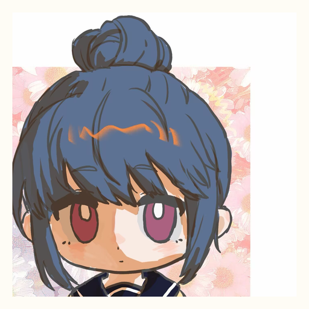
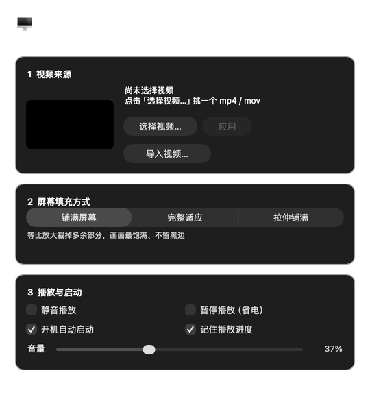

<div align="center">



# VideoWallpaper

**把视频铺在 macOS 桌面上**

位于桌面图标之下、系统壁纸之上 —— 图标照常显示、照常点击、照常框选，
就像系统原生壁纸一样，只不过它是会动的。

原生 Swift / AppKit 实现 · 无 Electron · 无运行时依赖

</div>

---

## 目录

- [特性](#特性)
- [环境要求](#环境要求)
- [安装](#安装)
- [使用](#使用)
- [技术实现](#技术实现)
- [开发](#开发)
- [常见问题](#常见问题)
- [已知限制](#已知限制)
- [许可](#许可)

---

## 特性

|  |  |
| --- | --- |
| **真·桌面层** | 窗口层级为 `desktopIconWindow - 1`，压在桌面图标之下、盖住系统壁纸。鼠标事件穿透，右键菜单、框选、拖拽文件均不受影响 |
| **三种填充方式** | 铺满屏幕（默认，无黑边）／完整适应（不裁切）／拉伸铺满。切换只修改图层属性，瞬时生效且不重载视频 |
| **原生控制面板** | 选择视频、预览缩略图、查看分辨率／时长／文件大小、调节音量、切换填充方式，全部图形化操作 |
| **独立音量控制** | 音量与静音状态分开保存。静音仅关闭输出，音量值保留；拖动滑块会自动解除静音 |
| **视频导入** | 将视频复制进 App 素材库并立即启用，带进度反馈。原文件后续移动或删除均不影响播放 |
| **多显示器支持** | 每块屏幕独立窗口，各自按屏幕尺寸填充，共用同一个播放器实例（仅解码一份）。显示器插拔时增量更新 |
| **低功耗** | 屏幕休眠、锁屏、系统睡眠时自动暂停解码，唤醒后恢复。`AVPlayerLayer` 直接渲染进图层树，不经过 CPU 合成 |
| **无缝循环** | 基于 `AVPlayerLooper` 的双 item 交替，循环点无可见中断 |
| **状态持久化** | 填充方式、音量、静音、播放进度、开机自启等设置均自动保存，重启后恢复 |
| **后台运行** | `LSUIElement` 应用：不占用 Dock、不出现在 `Cmd+Tab`，仅在菜单栏保留一个图标 |
| **可定制图标** | 替换 `icon/icon-source.png` 后在构建时自动生成 `.icns` |

---

## 环境要求

| 项目 | 要求 |
| --- | --- |
| 系统 | macOS 12.0 (Monterey) 或更高 |
| 工具链 | Xcode 或 Command Line Tools（提供 `swiftc`） |

安装命令行工具：

```bash
xcode-select --install
```

无需 Node.js、Python、Homebrew 或任何第三方依赖。

---

## 安装

```bash
git clone https://github.com/Ponochores/MacOS-Desktop-VideoWallpaper-ai-generated-.git
cd VideoWallpaper

# 首次构建安装器
mkdir -p "安装器.app/Contents/MacOS"
swiftc -O -o "安装器.app/Contents/MacOS/Installer" \
  Installer/Installer.swift -framework Cocoa

open 安装器.app
```

双击 **`安装器.app`** 即完成全部流程：编译 → 组装 App 包 → ad-hoc 签名 →
停止旧实例 → 安装到 `/Applications`（不可写时回退至 `~/Applications`）→ 启动。

整个过程为图形界面，编译日志写入 `build/build.log`。

> **关于安装器**：仓库不包含编译好的二进制。它是架构相关的（arm64 / x86_64 各一份），
> 且二进制无法审查。首次编译约需数秒。

安装完成后，`安装器.app` 会自行保持最新 —— 后续修改源码后重新双击即可。

<details>
<summary>首次启动被系统拦截？</summary>

本应用为 ad-hoc 签名（未使用 Apple 开发者证书）。若系统提示「无法验证开发者」，
前往 **系统设置 → 隐私与安全性**，点击「仍要打开」。

若从网络下载后提示「应用已损坏」，清除隔离属性即可：

```bash
xattr -cr /Applications/VideoWallpaper.app
```
</details>

---

## 使用

应用在后台运行，通过菜单栏图标操作。

### 菜单栏

| 操作 | 快捷键 |
| --- | --- |
| 打开控制面板 | `⌘,` |
| 更换视频 | `⌘O` |
| 暂停 / 继续播放 | `⌘P` |
| 静音 / 取消静音 | `⌘M` |
| 隐藏 / 显示桌面壁纸 | `⌘H` |
| 退出 | `⌘Q` |

**更换视频**也可以通过将 `mp4` / `mov` / `m4v` 文件直接拖拽到应用图标上完成。

### 界面



控制面板分为三组：**视频来源**（选择 / 应用 / 导入）、**屏幕填充方式**（三档切换）、
**播放与启动**（静音、暂停、开机自启、进度记忆、音量）。

### 填充方式

| 选项 | `AVLayerVideoGravity` | 效果 |
| --- | --- | --- |
| **铺满屏幕**（默认） | `.resizeAspectFill` | 等比放大至覆盖整屏，超出部分裁切。画面饱满，无黑边 |
| 完整适应 | `.resizeAspect` | 完整显示整段视频，比例不一致时四周留黑边 |
| 拉伸铺满 | `.resize` | 拉伸至整屏尺寸，比例不一致时画面变形 |

> 当视频宽高比与屏幕不一致时，「铺满屏幕」会裁切部分画面。若需保留完整构图，请选择「完整适应」。
> 两者比例越接近，三种模式的差异越小。

### 音量

设置面板提供音量滑块，拖动即时生效。音量值与静音状态独立保存：

- 静音仅关闭音频输出，**音量值本身保留**，取消静音后恢复到先前设定
- 拖动音量滑块会自动解除静音
- 音量标签显示 `60%` 或 `60%` 加静音标记，可直观区分「无音频」与「已静音」

### 视频来源

|  | 选择视频 | 导入视频 |
| --- | --- | --- |
| 行为 | 引用原文件 | 复制到 App 素材库 |
| 速度 | 立即 | 需等待复制，带进度反馈 |
| 原文件删除后 | 播放失效 | 不受影响 |
| 适用场景 | 临时预览 | 长期使用 |

导入的视频保存在：

```
~/Library/Application Support/VideoWallpaper/Videos/
```

同名文件会自动追加序号，不会覆盖。使用导入的视频时，面板会显示「移除已导入」
（仅删除素材库中的副本，不影响原始文件）。

### 开机自启

控制面板 → 「开机自动启动」。底层优先使用系统 API（`SMAppService`），
不可用时自动回退为写入 `LaunchAgent`。

---

## 技术实现

### 窗口层级

桌面图标层在 macOS 窗口层级中高于系统壁纸层。将窗口置于两者之间：

```swift
level = NSWindow.Level(rawValue: Int(CGWindowLevelForKey(.desktopIconWindow)) - 1)
```

即可同时满足「覆盖系统壁纸」与「图标保持最上层」。配合 `ignoresMouseEvents = true`，
鼠标事件穿透至桌面，右键菜单、框选、拖拽文件均正常工作。

窗口的 `collectionBehavior` 设为 `[.canJoinAllSpaces, .stationary, .ignoresCycle]`：
在所有桌面空间显示，不参与 Mission Control 重排，`Cmd+\`` 无法切入。

### 架构

```
控制面板 / 菜单栏  ──修改──▶  AppConfig（唯一状态源）
                                  │  NotificationCenter 广播变更
                                  ▼
                          WallpaperController（响应变更）
                                  │
                                  ▼
                       每块屏幕一个 WallpaperWindow
                                  │  全部绑定同一个 AVQueuePlayer
                                  ▼
                          PlayerView（AVPlayerLayer）
```

界面层不直接操作播放器，播放器也不读取界面状态。新增配置项只需三步：
在 `AppConfig` 添加属性并在 setter 中广播、在 `WallpaperController` 中处理该通知、
在 `PreferencesWindow` 中呈现状态。状态不会出现不一致。

### 播放器复用

所有屏幕的 `AVPlayerLayer` 指向同一个 `AVQueuePlayer` 实例。各图层维护自己的
frame 与 `videoGravity`，但解码器仅有一份，多显示器不会成倍增加 GPU 开销。

### 功耗控制

| 场景 | 监听通知 | 行为 |
| --- | --- | --- |
| 屏幕休眠 / 唤醒 | `NSWorkspace.screensDidSleep/Wake` | 暂停 / 恢复解码 |
| 锁屏 / 解锁 | `sessionDidResign/BecomeActive`、`com.apple.screenIsLocked` | 暂停 / 恢复 |
| 系统睡眠 / 唤醒 | `NSWorkspace.willSleep/didWake` | 暂停 / 恢复 |
| 手动暂停 | `AppConfig.isPaused` | 保留窗口，停止解码 |

图层 frame 同步包裹在 `CATransaction` 中并禁用隐式动画，避免尺寸变化时画面抖动。

### 退出处理

`SIGTERM` / `SIGINT` / `SIGHUP` 被转换为 `NSApp.terminate`，使
`applicationWillTerminate` 得以执行：播放进度正常保存，不残留窗口。
关机、重启、脚本终止均走此路径。

---

## 开发

### 构建

```bash
# 完整流程：构建 + 安装 + 启动
./安装器.app/Contents/MacOS/Installer --headless

# 仅构建，不安装、不启动（推荐在开发时使用）
./安装器.app/Contents/MacOS/Installer --build-only
```

产物位于 `build/VideoWallpaper.app`。

项目使用 `swiftc` 直接编译，**不依赖 Xcode 工程文件**。因此无法使用 Xcode 调试器；
需要断点调试时，可自行创建一个指向 `Sources/` 的 Xcode 工程。

### 界面自查

屏幕录制权限受限时 `screencapture` 不可用。项目内置离屏渲染工具，可将控制面板导出为 PNG：

```bash
swiftc -swift-version 5 -module-cache-path build/modulecache \
  -o /tmp/harness UIHarness/main.swift UIHarness/Harness.swift \
  Sources/AppConfig.swift Sources/PlayerView.swift \
  Sources/WallpaperController.swift Sources/PreferencesWindow.swift \
  Sources/VideoImporter.swift \
  -framework Cocoa -framework AVFoundation -framework CoreGraphics -framework ServiceManagement

/tmp/harness /tmp/panel.png
```

`UIHarness/Harness.swift` 会同时打印各控件的真实 frame，可用于排查重叠。

检查运行中的窗口层级与尺寸：

```swift
CGWindowListCopyWindowInfo([.optionAll], kCGNullWindowID)
```

壁纸窗口的 layer 应为 `-2147483604`，即 `kCGDesktopIconWindowLevel - 1`。

### 更换图标

将新图保存为 `icon/icon-source.png`，重新构建即可（构建流程会自动调用 `icon/build-icon.sh`）。
调整取景可通过环境变量：

```bash
CROP_SIZE=1400 CROP_X=400 CROP_Y=100 MARGIN_RATIO=0.04 ./icon/build-icon.sh
```

| 变量 | 含义 | 默认 |
| --- | --- | --- |
| `CROP_X` / `CROP_Y` | 裁剪起点（像素） | 居中偏上 |
| `CROP_SIZE` | 裁剪边长（像素） | 源图宽度的 73% |
| `MARGIN_RATIO` | 图标四周留白比例 | `0.04` |

### 测试

`VideoImporter` 为不依赖 UI 的纯逻辑模块，可独立编译运行断言：

```bash
mkdir -p /tmp/vwtest && cp <测试文件> /tmp/vwtest/main.swift
swiftc -swift-version 5 -module-cache-path build/modulecache \
  -o /tmp/vwtest/importer_test /tmp/vwtest/main.swift Sources/VideoImporter.swift
/tmp/vwtest/importer_test
```

> Swift 的顶层代码必须位于名为 `main.swift` 的文件中。

覆盖范围：进度单调递增、终值到达 1.0、字节数与源文件一致、内容哈希一致、
重名自动追加序号、取消时清理半成品、源文件缺失时清理目标文件。

### 项目结构

```
├── 安装器.app/                  图形化安装器（首次需编译，见「安装」）
├── Installer/Installer.swift    安装器源码，支持 --headless / --build-only
├── Sources/
│   ├── AppConfig.swift             配置中心：状态源、持久化、变更广播
│   ├── PlayerView.swift            渲染层：AVPlayerLayer、填充模式、元数据
│   ├── WallpaperController.swift   播放引擎：窗口层级、多屏管理、功耗策略
│   ├── PreferencesWindow.swift     控制面板 UI
│   ├── VideoImporter.swift         视频导入：分块复制、进度、失败清理
│   ├── AppDelegate.swift           菜单栏、菜单、应用生命周期
│   └── main.swift                  入口与信号处理
├── Resources/default.mp4       内置示例视频
├── icon/                       图标源图与生成脚本
├── UIHarness/                  离屏渲染工具
├── Info.plist                  Bundle 配置
├── DEVELOPMENT.md              开发笔记
└── CHANGELOG.md                版本历史
```

### 模块职责

| 文件 | 职责 |
| --- | --- |
| `AppConfig` | 所有配置项的唯一来源，负责持久化与变更广播 |
| `PlayerView` | 图层渲染、填充模式映射、播放元数据 |
| `WallpaperController` | 窗口层级、多屏管理、播放器生命周期、功耗策略 |
| `PreferencesWindow` | 控制面板 UI，仅修改 `AppConfig` |
| `VideoImporter` | 文件复制与进度回报，不涉及 UI |
| `AppDelegate` | 菜单栏与生命周期，不处理播放逻辑 |

### 偏好存储

使用 `UserDefaults.standard`，存储域为 bundle id（`local.vk.wallpaper`）。

```bash
defaults read local.vk.wallpaper
```

---

## 常见问题

**桌面图标会被遮挡吗？**
不会。窗口层级刻意置于图标层之下，图标始终位于最上层；`ignoresMouseEvents` 使鼠标事件穿透。

**会增加耗电或发热吗？**
视频解码由 GPU 硬件加速，常规使用功耗很低。锁屏与休眠时会暂停解码。
如需进一步降低占用，可从菜单栏手动暂停。

**多显示器、不同分辨率如何处理？**
每块屏幕拥有独立窗口，各自按屏幕尺寸填充。所有窗口共用一个播放器实例，
仅解码一份，多屏不会成倍增加开销。

**支持哪些视频格式？**
任何 AVFoundation 可解码的格式，常用 `mp4` / `mov` / `m4v`。
建议使用分辨率不低于屏幕的视频，否则铺满时会模糊。

**如何开机自启？**
控制面板 → 「开机自动启动」。底层优先使用 `SMAppService`，不可用时回退至 `LaunchAgent`。

**如何完全卸载？**

```bash
rm -rf /Applications/VideoWallpaper.app
defaults delete local.vk.wallpaper
rm -f ~/Library/LaunchAgents/local.vk.wallpaper.plist
rm -rf ~/Library/Application\ Support/VideoWallpaper
```

**支持 Windows 或 Linux 吗？**
不支持。本项目基于 AppKit 与 AVFoundation，仅适用于 macOS。

---

## 已知限制

- 仅支持 macOS，从源码构建需要 `swiftc`
- 使用 ad-hoc 签名（无 Apple 开发者证书），首次运行可能需要手动放行
- 不支持播放列表，也不支持按时间自动切换视频
- 暂无自动化测试套件；`VideoImporter` 具备可独立运行的断言测试范式，但尚未接入 CI
- `Resources/default.mp4` 为演示素材，版权归原作者，不在 MIT 授权范围内；分发前请替换

---

## 许可

[MIT](LICENSE)

示例视频仅用于演示，版权归原作者所有，不包含在 MIT 授权范围内。
